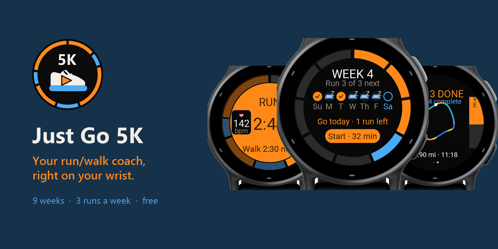
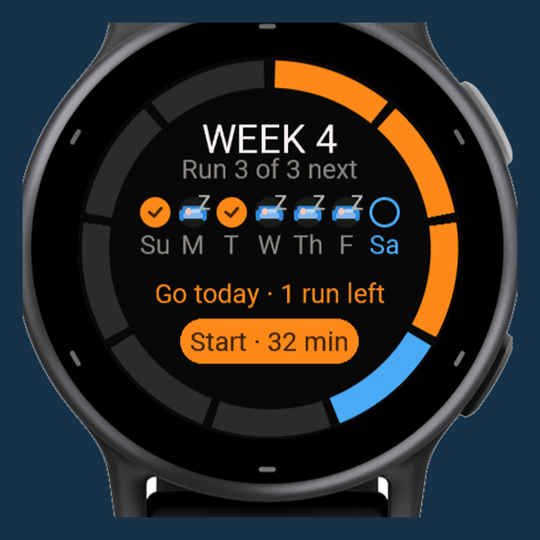
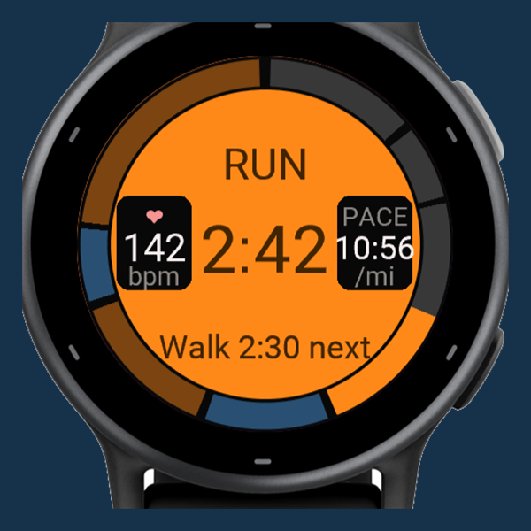
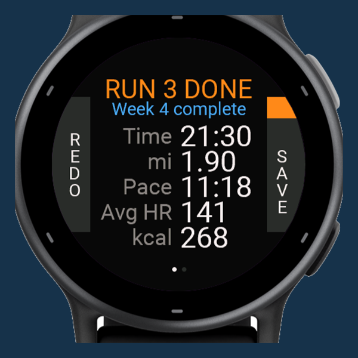
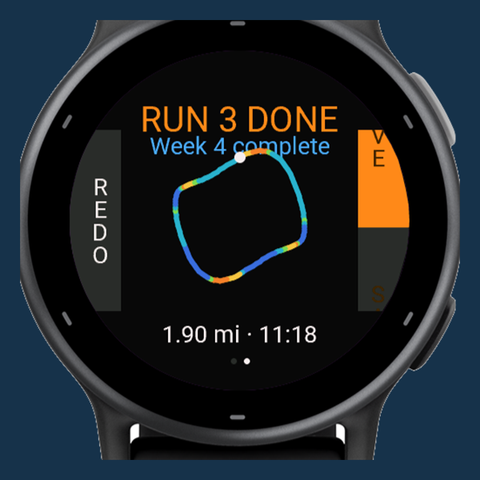
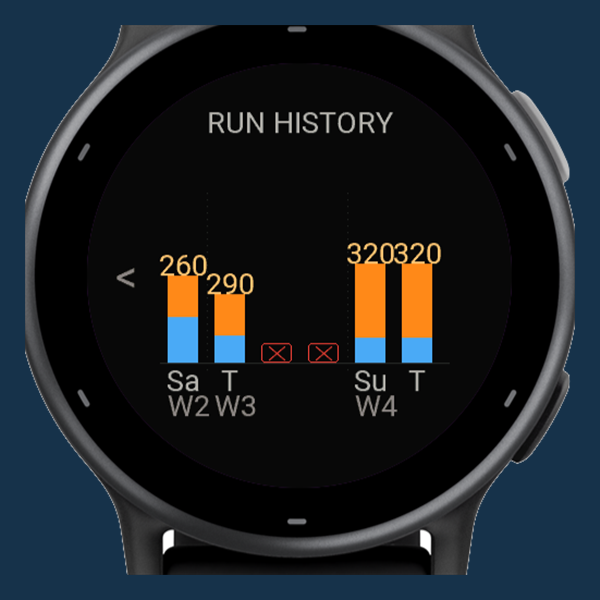
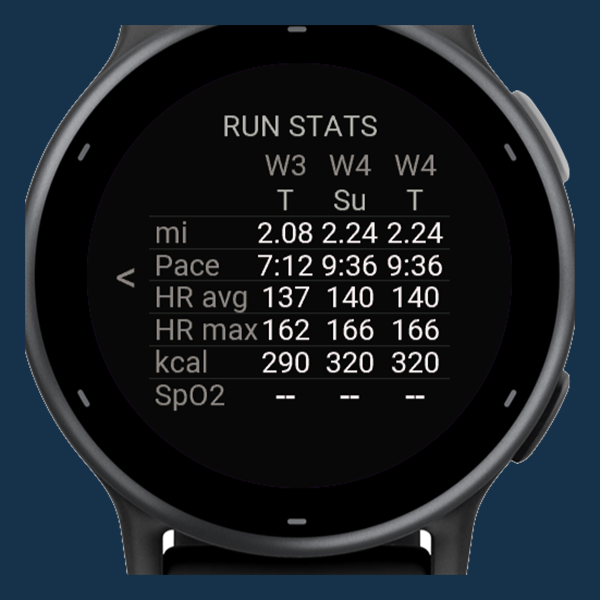
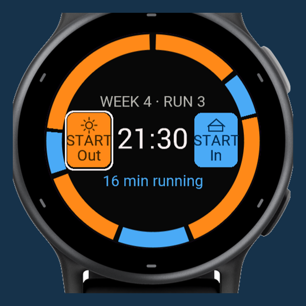
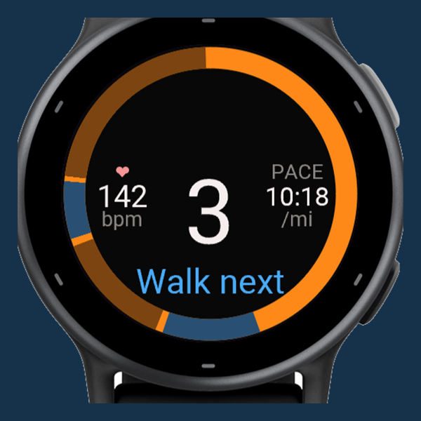
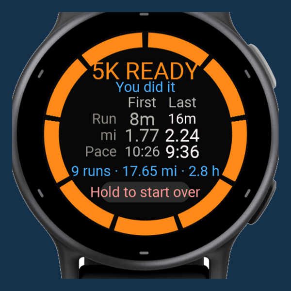

# Just Go 5K

**A beginner run/walk coach that lives on your Garmin watch. 9 weeks from your first jog to running 30 minutes non-stop, with no phone needed during the run.**



Just Go 5K is a free, open-source Connect IQ watch app. It is being prepared for the **Garmin Connect IQ Store** (private beta first, then public release). Until then you can build it yourself or sideload the `.prg` (see below).

## What makes it different

- **Coached entirely from the wrist.** The screen switches between run and walk by itself, with a 3-2-1 countdown and distinct vibrations for "run", "walk" and "warm-up/cool-down". You never touch the watch mid-run, and you never need your phone.
- **A plan that fits real life.** Weeks are calendar weeks (Sunday to Saturday) and you choose your own run days. A gentle "go today" nudge appears when the week is running out. Miss runs and the plan still moves on, so there is no falling behind and no guilt spiral.
- **Honest stats.** Warm-up and cool-down are kept out of the recorded activity, and pace uses moving time, so your numbers show the real workout. Every run is a normal Garmin running activity with **one lap per run/walk interval**.
- **Pace colours that mean the same thing every time.** The pace map colours your route on a fixed scale, from blue (walking) to red (sprinting). It never rescales per run, so you can see yourself getting faster week by week.
- **Fits the watch you have.** Built for the vívoactive 5 first, and laid out for **111 colour watches**: round AMOLED, round MIP (including 16-colour), and square screens. Layouts measure their own text, so small screens get shorter wording instead of overlapping text.
- **Private by design.** No accounts, no internet, no tracking. History stays on the watch; activities sync only through your own Garmin Connect or Gadgetbridge setup. See [PRIVACY.md](store/PRIVACY.md).
- **Works with Gadgetbridge** as well as Garmin Connect, for people who prefer an open-source phone companion.

## Screenshots

| Weekly progress | Run interval | Summary |
|---|---|---|
|  |  |  |
| **Pace map** | **History** | **Stats** |
|  |  |  |
| **Start outdoor or indoor** | **3-2-1 countdown** | **Graduation** |
|  |  |  |

## How the plan works

- 3 runs a week for 9 weeks, starting with 1-minute jogs and building to a 30-minute run.
- Every session has a 5-minute warm-up walk and a 5-minute cool-down.
- Finish all 3 runs and the next week unlocks on Sunday. Starting mid-week? Do bonus warm-up runs; week 1 begins the following Sunday.
- Choose **Start Outdoor** (GPS) or **Start Indoor** (treadmill, pace from wrist motion) each time.
- A graduation screen compares your first run with your last.

Full store text: [store/LISTING.md](store/LISTING.md). Design spec: [docs/DESIGN.md](docs/DESIGN.md).

## Status

- All screens built and checked in the Connect IQ simulator across representative watches; 20 unit tests cover the weekly rules (including daylight-saving weeks), routes, pace and storage limits.
- Next: outdoor testing on a real vívoactive 5, then a private beta on the Connect IQ Store, then public release.

## Build it yourself

Requires the [Connect IQ SDK](https://developer.garmin.com/connect-iq/) (9.x) and your own developer key.

```sh
# one watch, loaded into the simulator
CIQ_DEV_KEY=/path/to/developer_key.der scripts/sim.sh vivoactive5

# release build for one watch (sideload: copy to GARMIN/Apps on the watch over USB)
monkeyc -r -f monkey.jungle -d vivoactive5 -o JustGo5K.prg -y /path/to/developer_key.der

# unit tests
monkeyc -t -f monkey.jungle -d vivoactive5 -o bin/unittest.prg -y /path/to/developer_key.der
monkeydo bin/unittest.prg vivoactive5 -t
```

`test.jungle` (runs a session at 20× speed) and `tour.jungle` (cycles through every screen) are for simulator testing only.

## Health note

Before starting any exercise programme, check with your doctor if you have any health concerns.

## License

[GPL-3.0](LICENSE) © HappyRock616. You may reuse and change this code with credit; shared changes must stay open source under the same licence.

Not affiliated with or endorsed by Garmin. Garmin, Connect IQ and vívoactive are trademarks of Garmin Ltd. or its subsidiaries.
